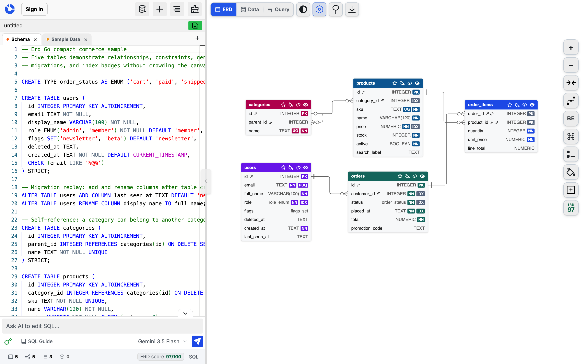

<p align="center">
  
</p>

<h1 align="center">ERD Go</h1>

<h3 align="center">Free, local-first SQL-to-ERD converter and database diagram editor.</h3>

<p align="center">PostgreSQL · MySQL · SQLite · SQL Server · No account</p>

<p align="center">
  <a href="https://erdgo.com/">
    
  </a>
  <a href="https://github.com/tanlee102/ErdGo/stargazers">
    
  </a>
  <a href="LICENSE">
    
  </a>
  <a href="https://x.com/Erd_Go">
    
  </a>
</p>

<p align="center">
  
</p>

<p align="center"><strong>If ERD Go helps you, please star the repository so more developers can discover it.</strong></p>

## SQL to ERD in your browser

ERD Go is an open-source, browser-based database schema visualizer. Paste or import SQL DDL and instantly generate an interactive entity-relationship diagram—without creating an account or sending your schema to an application backend.

It understands common `CREATE TABLE` and `ALTER TABLE` workflows, primary and foreign keys, indexes, constraints, enums, composite types, and views across popular SQL dialects.

## Highlights

- Convert PostgreSQL, MySQL, SQLite, and SQL Server schemas into ER diagrams.
- Explore relationships, arrange tables, apply colors, and navigate with a minimap.
- Edit table names and columns directly on the canvas, with tab-aware SQL updates and destructive-change review.
- Reconnect supported foreign keys, create relationships from column handles, and review inferred relationships.
- Export database diagrams as PNG, SVG, or PDF.
- Replay schema and sample-data SQL in Data View.
- Run supported read-only `SELECT` queries in Query View.
- Save diagrams locally in your browser and reopen them later.
- Visualize Prisma schemas with searchable models, fields, relations, and diagnostics.
- Design conceptual diagrams in ERD Builder, including attributes, cardinality, undo/redo, layout, and reviewed SQL export.
- Convert CSV, TSV, text, and XLSX worksheets into SQL with type overrides and issue reports.
- Optionally edit SQL with Gemini using your own API key.

## Tools

| Tool | Route | Workflow |
| --- | --- | --- |
| SQL to ERD | `/e/new` | Import or edit SQL tabs; explore ERD, Data, and Query views |
| Prisma to ERD | `/prisma-to-erd/new` | Paste Prisma source; inspect and export its diagram |
| ERD Builder | `/erd-builder/new` | Draw a conceptual model; review its SQL mapping and open it in SQL to ERD |
| Spreadsheet to SQL | `/spreadsheet-to-sql` | Import a worksheet; preview, copy, or download generated SQL |
| Tool guides | `/docs` | Learn each browser workflow and its limitations |

SQL, Prisma, and Builder documents share the local diagram list. The homepage links to recent documents; each workspace opens saved documents from its file button. Spreadsheet conversion is temporary, so download SQL before leaving it.

Data View and Query View implement an in-memory SQL subset; they do not connect to a database server. Canvas edits refuse changes whose dependent SQL cannot be updated safely; edit those statements together in the SQL editor. Prisma and Builder surface conversion diagnostics rather than running migrations. Spreadsheet input is limited to 25 MiB; legacy `.xls` and encrypted workbooks are unsupported. SVG and PDF exports contain a diagram image rather than editable vector shapes or selectable text.

## Common uses

- Visualize an existing database schema from SQL.
- Design and document relational database structures.
- Review tables, keys, constraints, and relationships.
- Create shareable ERD exports for development and documentation.

## Run locally

Requires Node.js 20.19+, 22.13+, or 24+. Use a supported even-numbered Node release.

```bash
git clone https://github.com/tanlee102/ErdGo.git
cd ErdGo
npm ci
npm run dev
```

Open `http://localhost:3000`. `npm run check` runs lint, the regression tests, and a production build.

For browser workflow tests, build first, then install Chromium and run Playwright:

```bash
npm run check
npx playwright install chromium
npm run test:e2e
```

If Chrome is already installed, `PLAYWRIGHT_CHANNEL=chrome npm run test:e2e` uses it. Set `PLAYWRIGHT_PORT` when port 4173 is occupied. The test server starts a local production preview and never contacts an application backend.

## Privacy

Diagrams stay in your browser. ERD Go has no accounts, cloud sync, sharing service, or analytics.

Existing SQL documents and renderer context under `erdgo:documents:v1` remain readable. Prisma and Builder add typed payloads to that same store. Clearing browser storage removes saved diagrams; export important work as a backup. Monaco's default loader downloads editor code from a public CDN; this does not upload your schema.

The optional AI editor contacts Gemini only after you provide your own API key and make a request. Never use production credentials or sensitive schema data with a third-party provider.

## Community

Contributions are welcome. Read the [contributing guide](CONTRIBUTING.md), [architecture notes](docs/architecture.md), and [code of conduct](CODE_OF_CONDUCT.md) before opening a pull request.

- [Report a bug](https://github.com/tanlee102/ErdGo/issues/new?template=bug_report.yml)
- [Request a feature](https://github.com/tanlee102/ErdGo/issues/new?template=feature_request.yml)
- [Get help](SUPPORT.md)
- [Report a vulnerability privately](SECURITY.md)
- [View the changelog](CHANGELOG.md)
- [Read the update notes](docs/upstream-sync.md)

## License

[MIT](LICENSE)
